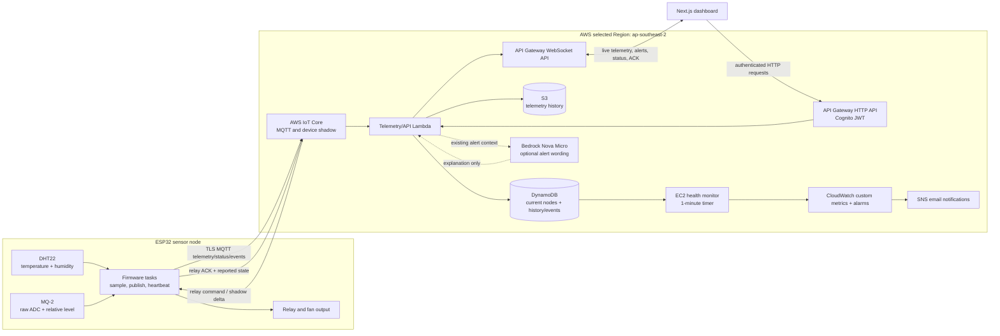
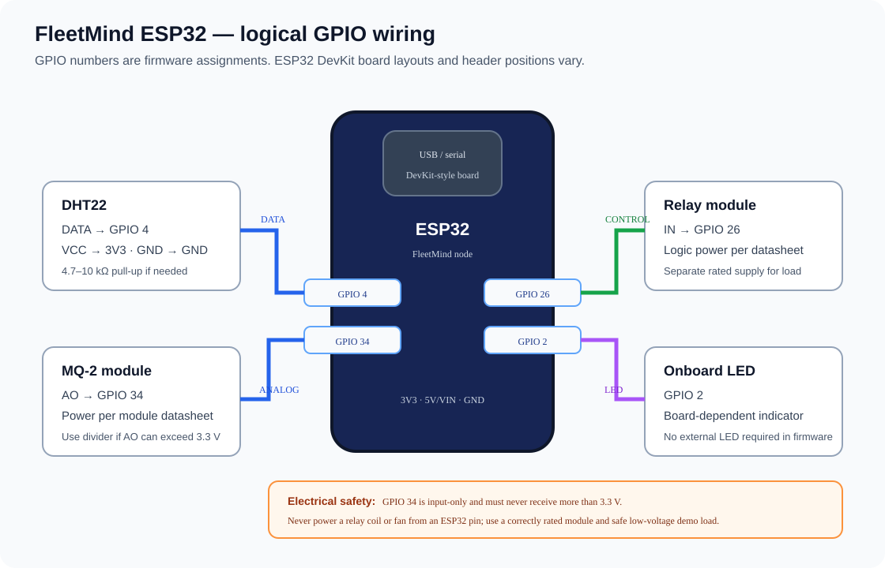

# FleetMind

**An ESP32 and AWS IoT prototype for live environmental telemetry, device health, and relay monitoring.**

FleetMind connects an ESP32 sensor node to an authenticated web dashboard. The device reports temperature, humidity, and a relative MQ-2 reading. AWS stores the readings, streams updates to the browser, records threshold events, and carries relay commands back to the board. Optional Bedrock text explains an alert after the existing threshold logic has raised it. A separate EC2 monitor publishes device-health metrics for CloudWatch and SNS.

> **Prototype safety notice:** MQ-2 is not calibrated for gas concentration, does not identify carbon monoxide, and is not a certified life-safety alarm. Dashboard thresholds are demo values. Keep certified alarms in service and test only with safe, controlled inputs.

## Project status

- **Project status: complete for the prototype/demo scope.** The user confirmed that the project tests and end-to-end checks have been completed, including telemetry, dashboard updates, threshold alerts, relay actions, Bedrock explanations, and device-health notifications.
- **Latest deployment:** the activity-history Lambda package is deployed. Its AWS code hash was checked against the local package on 2026-10-18.
- **ML anomaly detection:** training experiments were attempted, but did not produce production-quality FleetMind results. The model remains an offline experiment and does not affect live alerts or relay control.
- **Scope note:** the completed project is a working prototype, not a certified safety system or production-hardened service. Optional enhancements and deployment hardening are documented as future work, not unfinished acceptance tests.

See [Project status](docs/project-status.md) for completed work and future enhancements, and [Live testing log](docs/live-testing-log.md) for dated test outcomes.

## What it does

- Reads DHT22 temperature/humidity and MQ-2 analog values on the ESP32.
- Sends MQTT telemetry and retained online/relay status to AWS IoT Core.
- Stores readings and activity in DynamoDB and ingested telemetry JSON in S3.
- Streams current readings, status, and relay acknowledgements to a Next.js dashboard over API Gateway WebSockets.
- Shows threshold alerts based on configured prototype limits; optional automatic relay behavior remains explicitly controlled by the app configuration.
- Adds a short Bedrock explanation to an already-triggered threshold alert, with a rule-based fallback. Bedrock does not choose alert state or control the relay.
- Lets an operator enable device-health monitoring for a node. The EC2 monitor checks the last online status heartbeat against a 180-second window and publishes CloudWatch metrics; configured alarms notify through SNS.
- Includes a separate offline anomaly-model exercise for evaluation only.

## Architecture



The local CDK stack documents intended infrastructure. Existing AWS resources were configured and updated manually; compare the CDK output with live resources before deploying the full stack. See [AWS backend details](infra/README.md).

## ESP32 logical pin map

This is a **logical GPIO map**, not a physical board drawing. ESP32 DevKit board layouts vary. Confirm the printed GPIO labels on your exact board before wiring.



| ESP32 GPIO | Connects to | Notes |
| --- | --- | --- |
| GPIO 4 | DHT22 DATA | Add a 4.7–10 kΩ pull-up to 3.3 V if the sensor board does not include one. |
| GPIO 34 | MQ-2 analog output (AO) | ADC1 input-only pin. Keep the signal at or below 3.3 V; use a divider if the module output can exceed that. |
| GPIO 26 | Relay module IN | Relay board must accept 3.3 V logic. Do not connect a fan or relay coil directly to an ESP32 GPIO. |
| GPIO 2 | Onboard status LED | Present on many, but not all, ESP32 DevKit boards. |
| GND | Sensor and relay logic ground | Use a common ground unless the relay interface is isolated and wired according to its datasheet. |

Power the MQ-2 and relay module to their own specifications. Many MQ-2 modules use a 5 V heater; never let a 5 V analog output reach GPIO 34. For prototype testing, use an appropriately rated low-voltage fan and relay contacts. Do not wire mains voltage as part of this project demo.

The separate [hardware-test firmware](firmware/hardware-test/README.md) reads the sensors and accepts manual relay commands over Serial without Wi-Fi or AWS credentials.

## Application event workflows

The event map, payload examples, and lifecycle of each supported feature are documented in [Project events and workflows](docs/project-events.md). At a glance:

| Event / feature | Flow | Dashboard or AWS result |
| --- | --- | --- |
| Normal sensor reading | ESP32 → IoT telemetry topic → Lambda | DynamoDB/S3 record and live chart/tile update |
| Threshold crossing | Telemetry → existing threshold rules → event record | Persistent alert/activity item; optional Bedrock explanation |
| Manual relay command | Dashboard → authenticated API → IoT command → ESP32 → ACK | Confirmed relay state and activity entry |
| Device online/offline | Retained MQTT status + Last Will → Lambda → WebSocket | Near-real-time dashboard status; UI freshness window is 90 seconds |
| Missing status while monitoring is armed | Monitoring switch → DynamoDB flag → EC2 monitor → CloudWatch alarm → SNS | Device-health email after the 180-second status window and alarm evaluation |
| Model score | Offline Python scripts only | No live dashboard, SNS, or relay integration |

## Repository layout

```text
src/                         Next.js dashboard, API routes, stream handling
firmware/esp32-node/          AWS IoT-connected ESP32 firmware
firmware/hardware-test/       Bench test without AWS
infra/lib/                    CDK source for the intended AWS stack
infra/lambda/                 Telemetry/API, threshold event, Bedrock, relay logic
infra/health-monitor/         EC2 monitor, systemd timer, IAM policy source
ml/anomaly/practice/          Offline model experiments and evaluation notes
docs/project-events.md        Payload and end-to-end event workflows
docs/project-status.md        Completion status, scope, and future enhancements
docs/live-testing-log.md      Dated checks and observed outcomes
docs/                         Hardware, AWS, actuator, and model handoffs
```

## Run the dashboard locally

Requirements: Node.js compatible with the lockfile and npm.

```bash
npm install
npm run dev
```

Open [http://localhost:3000](http://localhost:3000). The live AWS dashboard requires the project environment values, Cognito sign-in configuration, and API/WebSocket outputs described in [Quick start](QUICKSTART.md). Local startup alone does not connect the ESP32 to AWS.

## Build and flash the ESP32

1. Open `firmware/esp32-node` in PlatformIO.
2. Copy `include/secrets.h.example` to `include/secrets.h`; add this device's Wi-Fi and AWS IoT credentials locally. Never commit the real file or certificate keys.
3. Set `NODE_ID` to the corresponding AWS IoT Thing name.
4. Build, flash, and open the Serial Monitor at 115200 baud:

```text
pio run
pio run --target upload
pio device monitor
```

Read [Firmware setup and MQTT contract](firmware/README.md) before wiring or changing the board configuration.

## MQTT topics and data path

For a node such as `node-01`:

| Topic | Direction | Purpose |
| --- | --- | --- |
| `fleetmind/node-01/telemetry` | ESP32 → AWS | Sensor samples, sequence, validity and raw ADC fields. |
| `fleetmind/node-01/status` | ESP32 → AWS | Retained online/RSSI/uptime/relay state; MQTT Last Will marks unexpected disconnect. |
| `fleetmind/node-01/events` | ESP32 → AWS | Actuator acknowledgements. |
| `fleetmind/node-01/commands` | AWS → ESP32 | Relay command with an action ID. |
| `$aws/things/node-01/shadow/update/delta` | AWS → ESP32 | Optional desired relay state. |
| `$aws/things/node-01/shadow/update` | ESP32 → AWS | Reported relay/fan state. |

The firmware reports `gasAdc` as the raw 0–4095 ADC count and `gasLevelEstimate` as a relative 0–1000 prototype level. The relative value is not gas ppm. See [Project events and workflows](docs/project-events.md) for representative JSON shapes and backend behavior.

## Safety and model limits

- MQ-2 readings depend on the specific sensor, heater, warm-up, voltage, and environment. The current scale is not calibrated.
- Demo threshold crossings show application behavior; they are not validated hazard limits.
- Bedrock explains the rule that already fired. A fixed explanation is used if the model call fails or returns unsuitable text.
- The ML prototype has no reviewed FleetMind anomaly dataset and produced false positives on confirmed normal holdout readings. It stays offline.
- Do not use the fan relay as a certified safety control. Keep independent certified alarms and use safe, controlled test payloads.

## Project lessons captured during development

- Keep device **status heartbeats** separate from sensor telemetry. The dashboard's 90-second online display and the optional 180-second SNS health rule serve different purposes.
- Include a current timestamp in synthetic MQTT tests. Old timestamps can be rejected or appear behind newer live board readings.
- Preserve device time and server receipt time. Receipt time orders live state; device time remains useful for charts and analysis.
- Validate the device's explicit online status before accepting test telemetry so an offline node cannot appear active from stale messages.
- Keep every command correlated by `actionId`; the dashboard should show the acknowledged result, not just the requested state.
- Separate operational health notifications from sensor threshold alerts and from experimental ML scores.
- Label synthetic events as synthetic. They prove the pipeline can process a payload; they are not physical sensor measurements or model ground truth.
- Treat the checked-in CDK as intended infrastructure, not an exact snapshot of console-created AWS resources. Review drift before deployment.

## Documentation

- [Quick start and local configuration](QUICKSTART.md)
- [Project status and handoff](docs/project-status.md)
- [Event payloads and complete workflows](docs/project-events.md)
- [Live test log](docs/live-testing-log.md)
- [ESP32 firmware and wiring](firmware/README.md)
- [AWS backend and routes](infra/README.md)
- [Device-health monitor and CloudWatch/SNS guide](docs/cloud-health-monitor-console-guide.md)
- [Threshold and relay behavior](docs/actuator-control.md)
- [Offline anomaly experiment and limitations](docs/anomaly-service-plan.md)

## License

No license file is currently included. Contact the project owner before reusing or redistributing this project.
