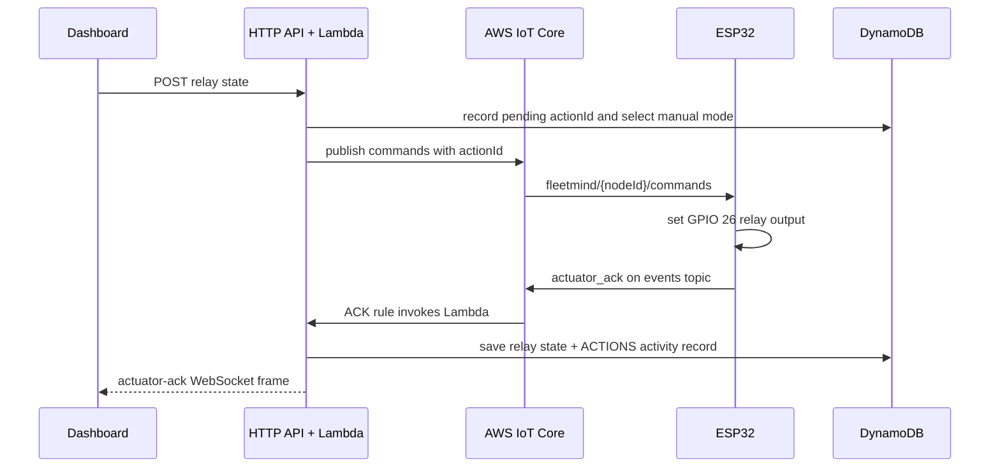
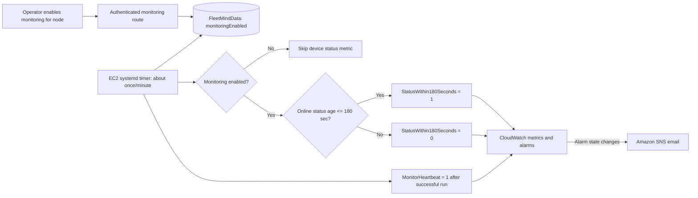

# FleetMind events and end-to-end workflows

This page describes the current application event flows. AWS resources are in the selected Region `ap-southeast-2`. The actual AWS stack was configured through the console and has known differences from the checked-in CDK; see [project status](project-status.md) before changing infrastructure.

## 1. ESP32 sensor telemetry

The sensor task samples every two seconds. The publisher sends changed readings immediately and sends unchanged readings on the same two-second cadence so the live chart continues to advance.

Firmware-shaped MQTT message on `fleetmind/{nodeId}/telemetry`:

```json
{
  "schemaVersion": 1,
  "nodeId": "node-01",
  "sequence": 42,
  "timestamp": 1792317410,
  "uptimeMs": 84000,
  "gasAdc": 367,
  "gasLevelEstimate": 89.6,
  "gasScale": "relative-0-1000",
  "temperatureC": 25.1,
  "humidityPct": 65.6,
  "sensorValid": true,
  "isAnomaly": false,
  "relayOn": false
}
```

The IoT rule invokes the telemetry Lambda. It validates and normalizes firmware field names (`temperatureC`, `humidityPct`, `gasLevelEstimate`) and dashboard/test-client field names (`temperature`, `humidity`, `gasLevel`). It stores the reading in the node telemetry partition, updates the latest node row, writes the original normalized event to S3, and broadcasts a `telemetry` WebSocket event. The authenticated dashboard updates the current cards, chart, and activity list.

Important timestamp behavior: the board timestamp may be zero before NTP sync; the cloud then uses receipt time. DynamoDB's server `receivedAt` orders current live node state, while the device reading timestamp remains the chart/history time. Use fresh timestamps in synthetic tests.

## 2. Threshold alert and explanation

The Lambda checks each accepted reading against the prototype thresholds currently in code: MQ-2 relative level `>= 400 / 1000` or temperature `>= 60 °C`. A firmware `isAnomaly: true` flag also records an alert. These are demo conditions, not calibrated gas limits.

```mermaid
sequenceDiagram
  participant Board as ESP32
  participant IoT as AWS IoT Core
  participant Fn as Telemetry Lambda
  participant DB as DynamoDB + S3
  participant FM as Bedrock (optional)
  participant UI as Dashboard
  Board->>IoT: telemetry reading
  IoT->>Fn: IoT rule invokes Lambda
  Fn->>Fn: validate, normalize, evaluate existing thresholds
  Fn->>DB: write telemetry + event; mirror alert to ALERTS
  Fn-->>UI: telemetry WebSocket frame with fallback explanation
  opt alert and Bedrock enabled
    Fn->>FM: explain the already-triggered threshold reasons
    FM-->>Fn: one short explanation
    Fn->>DB: replace fallback explanation when valid
    Fn-->>UI: alert-explanation WebSocket frame
  end
```

The fallback explanation remains available if Bedrock is disabled, fails, or returns wording that confuses gas and temperature. Bedrock does not set the alert, score sensor risk, publish SNS messages, or operate the relay. The dashboard activity drawer reads recent event rows through `GET /logs`; alerts use an `ALERTS` partition so frequent telemetry does not push them out of the returned history.

## 3. Manual relay command and acknowledgement

The dashboard sends `POST /nodes/{nodeId}/relay` with `{ "relayOn": true }` or `false`. The API requires Cognito authorization and rejects commands if the node is offline or its last-seen status is stale (older than the 90-second UI/API freshness window).



The board also publishes an immediate retained status update and a reported device-shadow state after applying a command. `actionId` correlates the request and acknowledgement. Relay ACK activity is written in both `FLEET` (general history) and `ACTIONS` (retained action history); `GET /logs` merges and deduplicates these sources.

The firmware also accepts AWS IoT Device Shadow desired-state deltas:

```json
{
  "state": {
    "relayOn": true,
    "actionId": "a1b2c3d4e5f6"
  }
}
```

After applying the change, the board publishes reported state to
`$aws/things/{nodeId}/shadow/update`:

```json
{
  "state": {
    "reported": {
      "relayOn": true,
      "fanOn": true,
      "updatedAt": 1792317410,
      "lastActionId": "a1b2c3d4e5f6"
    }
  }
}
```

## 4. Optional threshold-based relay automation

Automatic control is separate from recording an alert. The node must be online, the dashboard must select automatic mode, the deployment must allow automatic control, and valid on/off threshold settings must be configured. A cooldown prevents sending a command on every sample. The device ACK is still the confirmation of actual relay state.

This remains prototype behavior. Keep the relay on a harmless, correctly rated demo load; do not treat MQ-2 as life-safety detection or connect this prototype to safety-critical equipment.

## 5. Device status and dashboard online/offline state

The ESP32 publishes retained status about every 15 seconds and immediately after relay commands. An MQTT Last Will publishes `{ "nodeId": "node-01", "online": false }` if the connection drops unexpectedly. The status rule invokes Lambda, which updates node state and broadcasts `node-status`. The dashboard uses status events and its existing 90-second freshness behavior to show online/offline state and mark actuator state stale when appropriate.

The dashboard status display is independent of whether SNS monitoring is enabled. Turning the health-monitor switch off must not freeze or override the ordinary live online/offline display.

## 6. Opt-in device-health SNS alert

An authenticated dashboard request to `POST /nodes/{nodeId}/monitoring` stores `monitoringEnabled` on that node. The EC2 systemd timer runs about once a minute. For each configured and enabled node it reads `lastOnlineStatusAt` from `FleetMindData` and publishes `StatusWithin180Seconds=1` when the last online heartbeat is no more than 180 seconds old, otherwise `0`. It publishes `MonitorHeartbeat=1` only after a successful run.

CloudWatch alarms watch the per-node status metric and the monitor heartbeat / EC2 instance health. The device SNS email alert normally arrives only after the 180-second window plus CloudWatch alarm evaluation. When monitoring is intentionally off, the EC2 program skips that node's device metric, preventing a planned shutdown from being reported as a device outage. This does not change the dashboard's own online/offline display.



Current names in source: CloudWatch namespace `FleetMind/Health`, device metric `StatusWithin180Seconds` with `NodeId` dimension, and monitor metric `MonitorHeartbeat`. See [health monitor console guide](cloud-health-monitor-console-guide.md) for configured alarm names and safe acceptance steps.

## 7. Offline anomaly-model experiments

The Python scripts in `ml/anomaly/practice/` train and score local experiments. They do not receive live MQTT messages and are not connected to Lambda, the dashboard, SNS, or relay control. The FleetMind holdout had 19 readings confirmed by the user as normal and one deliberately synthetic 61 °C test; the detector flagged those unusual. Keep these outputs as evaluation candidates, not ground truth or deployed alerts.

## MQTT payload forms

### Online status heartbeat

Published retained on `fleetmind/{nodeId}/status` about every 15 seconds and
immediately after a relay command:

```json
{
  "nodeId": "node-01",
  "online": true,
  "rssi": -58,
  "uptimeMs": 84000,
  "relayOn": false,
  "commandQueueOverflow": false
}
```

An unexpected MQTT disconnect uses this Last Will form on the same topic:

```json
{ "nodeId": "node-01", "online": false }
```

The Lambda records server-side status receipt time. It stores
`lastOnlineStatusAt` only for online heartbeats, so an offline Last Will does
not erase the recent online time needed by the 180-second monitor.

### Relay command and acknowledgement

Cloud publishes to `fleetmind/{nodeId}/commands`:

```json
{ "actionId": "a1b2c3d4e5f6", "relayOn": true, "source": "dashboard" }
```

The device publishes to `fleetmind/{nodeId}/events`:

```json
{
  "eventType": "actuator_ack",
  "nodeId": "node-01",
  "actionId": "a1b2c3d4e5f6",
  "relayOn": true,
  "emergency": false,
  "result": "applied",
  "timestamp": 1792317410
}
```

The matching action ID joins the dashboard request to the board result. A
requested state is not a confirmed physical state until the device ACK arrives.

### Normalized MQTT test-client telemetry

The Lambda also accepts dashboard-friendly test fields. Use a current ISO
timestamp and clearly identify a test message:

```json
{
  "eventId": "safe-test-20261018-001",
  "nodeId": "node-01",
  "timestamp": "2026-10-18T10:30:00.000Z",
  "temperature": 25.0,
  "humidity": 55.0,
  "gasLevel": 450,
  "gasAdc": 1843,
  "sensorValid": true,
  "isAnomaly": true
}
```

This example crosses the current relative gas demo threshold and creates a
prototype alert if the message passes the online-node policy. Values injected
through MQTT are synthetic application inputs, not physical board measurements
or validated gas events.

## HTTP and WebSocket event reference

The dashboard uses Cognito JWT-protected HTTP routes:

| Route | Purpose |
| --- | --- |
| `GET /nodes` | Latest fleet-node state. |
| `GET /telemetry?nodeId=...&limit=...` | Recent telemetry history for one node. |
| `GET /logs?limit=...` | Recent activity, alert, and actuator action history. |
| `POST /ws-ticket` | Create a short-lived single-use ticket for an authenticated WebSocket connection. |
| `POST /nodes/{nodeId}/relay` | Request manual relay ON/OFF. |
| `POST /nodes/{nodeId}/automation` | Select manual or automatic threshold mode. |
| `POST /nodes/{nodeId}/monitoring` | Arm/disarm device-health SNS monitoring for a node. |
| `POST /telemetry` | Authenticated test/dashboard telemetry ingestion where enabled in the deployment. |

Dashboard WebSocket message types currently include `telemetry`, `node-status`, `control-mode`, `actuator-ack`, and `alert-explanation`. Verify the deployed API routes against the console before relying on CDK because the live console resources have drifted from the local stack declaration.

Representative non-telemetry frames:

```json
{"type":"node-status","nodeId":"node-01","online":true,"timestamp":"2026-10-18T10:30:00.000Z","relayOn":false,"rssi":-58}
{"type":"control-mode","nodeId":"node-01","automationEnabled":false,"timestamp":"2026-10-18T10:30:01.000Z"}
{"type":"actuator-ack","nodeId":"node-01","actionId":"a1b2c3d4e5f6","relayOn":true,"result":"applied","timestamp":"2026-10-18T10:30:02.000Z"}
{"type":"alert-explanation","nodeId":"node-01","logId":"node-01-safe-test-20261018-001","explanation":"The MQ-2 relative reading crossed the demo threshold. It is not a specific gas measurement or certified alarm.","explanationSource":"bedrock"}
```
